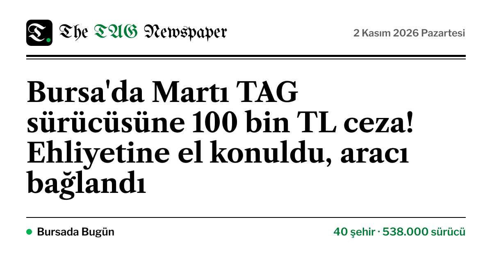
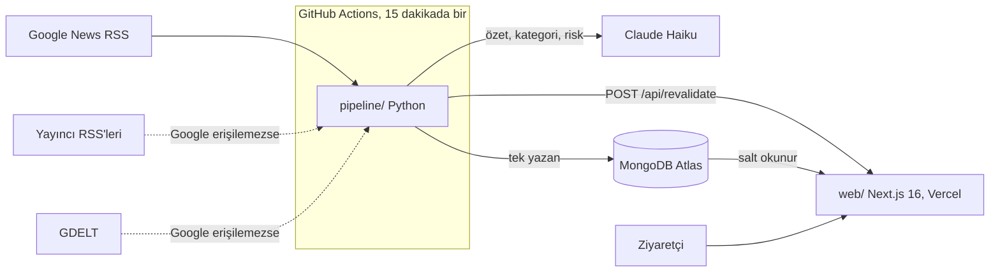

# TAGNEWSPAPER



**Martı TAG kullanıcıları için bağımsız haber, dava takibi ve veri gazetesi.**
Girişsiz, reklamsız, tek sayfalık bir "yeni nesil gazete": TAG hakkında çıkan haberleri toplar,
yapay zekâ ile kısa ve tarafsız özetlere dönüştürür, dava sürecini ve açıklanan rakamları
görselleştirir. Her öğe kaynağına bağlantı verir.

> TAGNEWSPAPER'ın Martı ile ya da herhangi bir tarafla bağlantısı yoktur. Gönüllü bir bilgi
> sayfasıdır; para kazanmaz, reklam almaz, Martı logosu kullanmaz.

**Canlı site:** https://tagnewspaper.vercel.app

## Sayfada neler var?

| Bölüm | Ne gösterir |
|---|---|
| Künye | Split-flap tabela, kayan manşet bandı; her gün 11.00'de yeni sayı |
| Gündem | En çok kaynağın yazdığı haber manşette; altında konuya göre süzülebilen haber akışı |
| Kaç kişi kullanıyor? | Şirketin açıkladığı son kullanıcı ve sürücü rakamları (canlı değildir) ve TAG'ın hizmet verdiği 40 şehrin haritası |
| Dava nerede? | Mahkeme kararlarının zaman çizelgesi; yalnızca doğrulanmış gelişmeler |
| Ne zaman konuşuldu? | Son 90 günün günlük haber sayısı, dava gelişmeleri işaretli |
| Kim yazdı? | Yayın organlarına göre haber dağılımı |
| Hangi konu öne çıktı? | Haftalara göre konu dağılımı (stream grafiği) |
| Kim ne diyor? | Tarafların haberlere yansıyan açıklamaları, atıf diliyle |
| Borsa (`/borsa`) | Martı hissesi (NYSE American: MRT) ve SEC başvuruları |


## Mimari



- **`pipeline/`**: Python 3.12 + uv. Haberleri çeker, tekilleştirir, aynı olayı yazan haberleri
  kümeler, kişisel verileri temizler, Claude Haiku ile özetler, güvenlik kurallarından geçirir ve
  sayfanın tüm verisini tek bir `snapshot` dokümanı olarak yazar.
- **`web/`**: Next.js 16 (App Router, Cache Components), TypeScript, Tailwind CSS 4, GSAP +
  ScrollTrigger, Lenis, d3. Sayfa tek bir veritabanı okumasıyla oluşur; pipeline her çalışmada
  önbelleği yeniler.
- **`shared/`**: İki tarafın uyduğu veri kontratı ([CONTRACT.md](shared/CONTRACT.md)) ve her iki test
  takımının okuduğu örnek JSON dosyaları.

## İçerik ilkeleri

Bu kurallar koda gömülüdür; otomatik yayın bunlardan geçmeyen içeriği özetsiz gösterir.

1. **Telif:** 2–3 cümlelik, kendi cümlelerimizle özet. Kaynaktan 12 kelimeden uzun birebir alıntı
   yok. Yayıncı görseli yok; her habere kimliğinden türetilen soyut bir kapak çizilir.
2. **Atıf:** İddia içeren haberler “…'ya göre / iddia etti” diliyle ve `İddia` etiketiyle verilir.
3. **Kişisel veri:** Telefon, plaka, TC kimlik no ve e-posta temizlenir; özel kişilerin adı
   yayımlanmaz. Tam metin saklanmaz.
4. **Doğrulama:** Dava gelişmeleri, metinleri birbirinden farklı en az iki kaynakta ya da birincil
   kaynakta (mahkeme, kurum, şirket açıklaması) geçiyorsa eklenir.
5. **Düzeltme:** Sitedeki künye ya da [düzeltme talebi şablonu](https://github.com/Yigtwxx/tagnewspaper/issues/new?template=correction.yml)
   üzerinden bildirilen içerik incelenir; gerekirse `python -m tagnews hide <id>` ile anında gizlenir.

Haberlerin tüm hakları yayımlayan kuruluşlara aittir. Özetler yapay zekâ ile üretilir ve hata
içerebilir; asıl bilgi her zaman bağlantı verilen kaynaktadır.

## Yerel geliştirme

Gereksinimler: Node.js 22+, [uv](https://docs.astral.sh/uv/).

```bash
# Web (veritabanı olmadan da çalışır)
cd web
cp .env.example .env.local
npm install
TAGNEWS_DEMO_DATA=1 npm run dev     # kurgusal örnek verilerle http://localhost:3000

# Pipeline
cd pipeline
cp .env.example .env               # ANTHROPIC_API_KEY ve MONGODB_URI değerlerini girin
uv sync
uv run python -m tagnews run --dry-run   # hiçbir şey yazmadan çeker ve sayar
uv run python -m tagnews run             # tam çalışma
```

### Ortam değişkenleri

| Değişken | Nerede | Açıklama |
|---|---|---|
| `ANTHROPIC_API_KEY` | pipeline | Claude API anahtarı |
| `ANTHROPIC_MODEL` | pipeline | Varsayılan `claude-haiku-5-5` |
| `MONGODB_URI` | ikisi de | Pipeline: yazma yetkili kullanıcı. Web: **salt okunur** kullanıcı |
| `MONGODB_DB` | ikisi de | Varsayılan `tagnewspaper` |
| `REVALIDATE_SECRET` | ikisi de | En az 32 karakter rastgele değer |
| `REVALIDATE_URL` | pipeline | `https://<site>/api/revalidate` |
| `NEXT_PUBLIC_SITE_URL` | web | Kanonik site adresi |
| `NEXT_PUBLIC_CONTACT_EMAIL` | web | Düzeltme talepleri için e-posta (isteğe bağlı) |
| `NEXT_PUBLIC_PUBLISHER_NAME` | web | Künyede gösterilecek yayıncı adı (isteğe bağlı) |

Gerçek değerler yalnızca `.env` dosyalarında (git'e girmez), GitHub Secrets'ta ve Vercel ortam
değişkenlerinde tutulur.

## Testler

```bash
cd web && npm run lint && npm run typecheck && npm test && npm run build
cd pipeline && uv run ruff check && uv run ruff format --check && uv run pytest
```

CI her push'ta ikisini de çalıştırır ([ci.yml](.github/workflows/ci.yml)). Haber toplama
[ingest.yml](.github/workflows/ingest.yml) ile 15 dakikada bir çalışır.

## Katkı

[CONTRIBUTING.md](CONTRIBUTING.md), [CODE_OF_CONDUCT.md](CODE_OF_CONDUCT.md) ve
[SECURITY.md](SECURITY.md) dosyalarına bakın.

## Lisans

Kaynak kodu [MIT](LICENSE) lisanslıdır. Lisans yalnızca kodu kapsar; haber içerikleri ve
markalar sahiplerine aittir.
